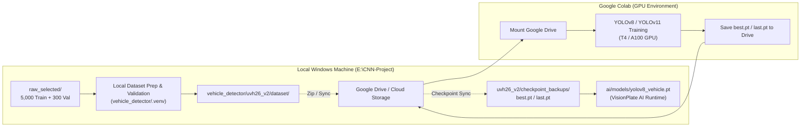

# VisionPlate AI — Local ML Environment & UVH-26 Dataset Setup

This document outlines the local machine learning directory architecture, environment configuration, and synchronization workflow for vehicle detection model development within **VisionPlate AI**.

---

## 1. Environment & Storage Overview

- **Project Root**: `E:\CNN-Project` (VisionPlate AI)
- **Host System**: Windows 11 (64-bit)
- **Primary Storage (Drive E)**:
  - Total Available Free Space: **~280.9 GB** (Sufficient for master dataset, processed splits, and checkpoints)
- **Local Python Environment**:
  - Python Version: **Python 3.14.3**
  - Isolated Venv Path: [`vehicle_detector/.venv`](file:///e:/CNN-Project/vehicle_detector/.venv)
  - Dependencies Spec: [`vehicle_detector/requirements-ml.txt`](file:///e:/CNN-Project/vehicle_detector/requirements-ml.txt)

---

## 2. Directory Architecture

All ML dataset assets, configurations, training outputs, and backups are strictly isolated within the existing project under `vehicle_detector/uvh26_v2/`:

```
E:\CNN-Project\vehicle_detector\
├── .gitignore                      # Protects large images, weights, and venv from Git
├── requirements-ml.txt             # Minimal requirements for dataset validation
├── .venv/                          # Dedicated local Python environment
└── uvh26_v2/
    ├── raw_selected/               # Master raw UVH-26 image storage (Persistent)
    │   ├── train/                  # 5,000 selected training images
    │   └── val/                    # 300 selected validation images
    ├── annotations/                # Original COCO/XML raw annotation files
    ├── manifests/                  # CSV/JSON manifests tracking curated sample IDs & metadata
    ├── dataset/                    # Formatted YOLO dataset (images/ + labels/)
    ├── config/                     # YOLO data.yaml configuration files
    │   └── uvh26_8class.yaml.example
    ├── runs/                       # Local inference evaluation / validation experiment logs
    └── checkpoint_backups/         # Downloaded checkpoints (*.pt) trained via Google Colab
```

---

## 3. Dataset Specification (UVH-26)

- **Source Dataset**: UVH-26 (Indian Traffic Monitoring & Vehicle Dataset)
- **Selection Scope**:
  - **Train split**: 5,000 curated images
  - **Validation split**: 300 curated images
  - Full 90 GB dataset is **not** downloaded locally; only the curated 5,300 subset is retrieved.
- **YOLO Target Mapping (8 Classes)**:
  1. `two_wheeler` (Motorcycle, Scooter, Two-wheeler)
  2. `three_wheeler` (Auto-rickshaw)
  3. `car` (Sedan, Hatchback)
  4. `suv_muv` (SUV, MUV)
  5. `bus` (Bus, Mini-bus)
  6. `truck` (Heavy Goods Truck)
  7. `lcv_van` (Light Commercial Vehicle, Tempo-traveller, Delivery Van)
  8. `bicycle` (Bicycle)

---

## 4. Local vs. Google Colab Workflow



1. **Persistent Master Hub (Local Windows Laptop)**:
   - Holds the master source files (`raw_selected`), curated manifests, and formatted YOLO text annotations.
   - Preserves offline copies and model checkpoint archives in `checkpoint_backups/`.
2. **GPU Training Engine (Google Colab)**:
   - Used exclusively for compute-heavy model training on T4/A100 GPUs.
   - Training scripts pull zipped/synced YOLO splits from Google Drive or cloud buckets.
   - Resulting `best.pt` weights are synced back down to `checkpoint_backups/` and deployed to `ai/models/yolov8_vehicle.pt` for inference.

---

## 5. Activating the Local Environment

To work in the dedicated ML environment from PowerShell:

```powershell
# Navigate to the project root
cd E:\CNN-Project

# Activate the dedicated ML virtual environment
.\vehicle_detector\.venv\Scripts\Activate.ps1

# (Optional) When ready to process manifests and validate images:
pip install -r vehicle_detector/requirements-ml.txt
```

---

## 6. Git Safety Rules

- Large image formats (`*.png`, `*.jpg`), zip archives, models (`*.pt`, `*.onnx`), and the `.venv/` directory are blocked by [`vehicle_detector/.gitignore`](file:///e:/CNN-Project/vehicle_detector/.gitignore).
- Do not commit dataset binaries or raw image collections to GitHub.
